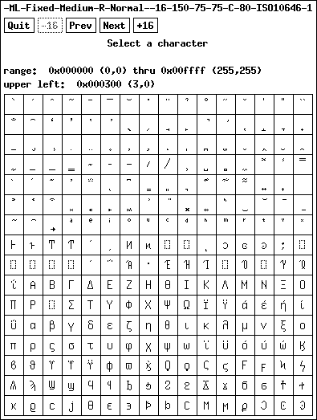

# Morning Light Fonts

Morning Light Fonts are fonts generated using machine learning.

All fonts included in the datasets are public domain X11 fonts,
misc fonts and Shinonome fonts. 

`FontMaskModel` is a Transformer-based masked vision model which predicts
masked tokens of the target font conditioned by the source fonts. The model
generates a target font with all characters included in the dataset.

Please note that this project is experimental. The generated font may not yet
meet production quality standards. Below is a comparison.

# Generated Font

Generated fonts are a collection of 4 fonts of consistent style with following
metrics:

- 6x12
- 6x13
- 7x14
- 9x18
- 10x20

These are main difference from the X11 misc fonts:

- They are a bit taller than the X11 misc fonts. For example X11 misc fonts has
`8x13.bdf` but we have `ml8x16.bdf`.
- They have 0 with slashes while the X11 misc fonts don't have.
- Some of characters, for example `C` and `G`, have rounder shapes.

Generated `ml8x16.bdf` characters:

## BDF Font

Download the generated BDF font: [fonts-ml-0.2.tar.gz](https://github.com/kaiidams/mlfont/releases/download/v0.2/fonts-ml-0.2.tar.gz).

## Metrics

Name | X Height | Cap Height | Descent | Ascent | Base
--- | --- | --- | --- | --- | ---
`6x12.bdf` | 5 | 7 | 2 | 10
`6x13.bdf` | 6 | 9 | 2 | 11
`7x14.bdf` | 7 | 10 | 2 | 12
`9x18.bdf` | 7 | 10 | 4 | 14
`10x20.bdf` | 8 | 13 | 4 | 16
`ml6x12.bdf` | 6 | 9 | 2 | 10 | `6x13.bdf`
`ml7x14.bdf` | 7 | 10 | 2 | 12 | `7x14.bdf`
`ml8x16.bdf` | 8 | 11 | 3 | 13 | `8x13.bdf`
`ml9x18.bdf` | 8 | 12 | 4 | 14 | `9x18.bdf`
`ml10x20.bdf` | 9 | 13 | 4 | 16 | `10x20.bdf`
